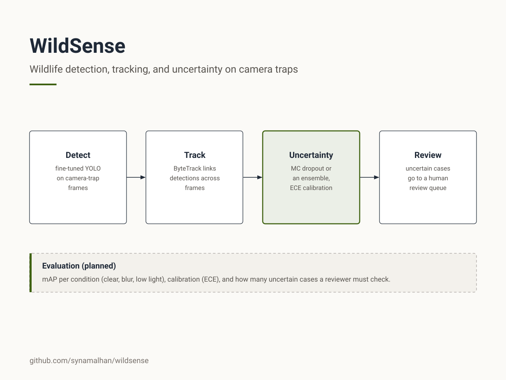

# WildSense

Wildlife detection, tracking, and uncertainty on camera traps.

> **Status: in progress.** This repo currently holds the design only. Nothing is implemented yet, and no results are reported until they are measured.

WildSense detects and tracks animals in challenging camera-trap footage and estimates how sure the model is. Uncertain cases are routed to a human review queue.

## Architecture

## Plan

- [ ] Fine-tune a YOLO detector on a subset of public camera-trap data
- [ ] Augment with blur, occlusion, and low light; compare against no augmentation
- [ ] Multi-object tracking across frames with ByteTrack
- [ ] Uncertainty estimates (MC dropout or an ensemble)
- [ ] Calibration report (ECE) and a human-review queue for uncertain cases
- [ ] Write-up

## Evaluation (planned)

mAP per condition, calibration (ECE), and how many uncertain cases a reviewer must check.

## Planned stack

Python, PyTorch, Ultralytics YOLO, ByteTrack, Albumentations.

## Notes

Datasets (for example Snapshot Serengeti, iWildCam, LILA BC) are not included. Check each license before use.
